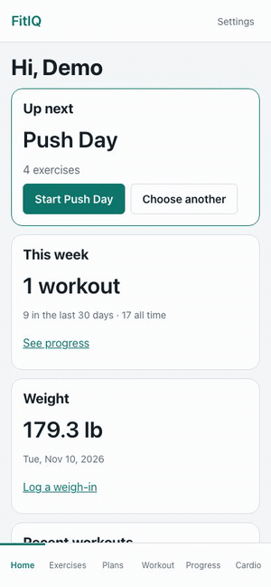
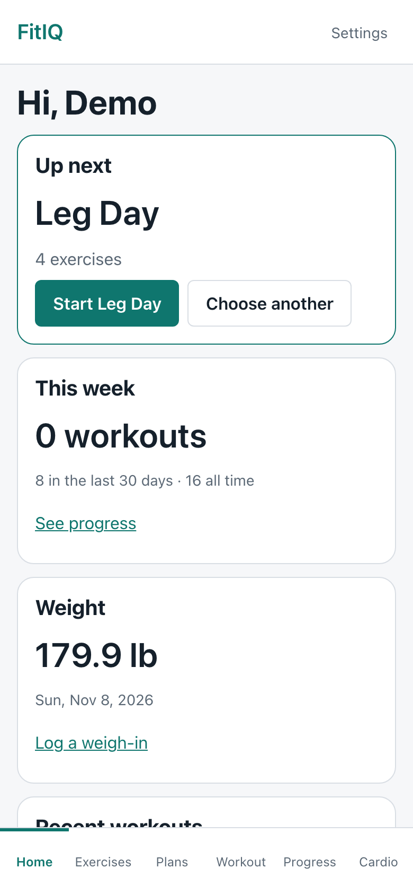
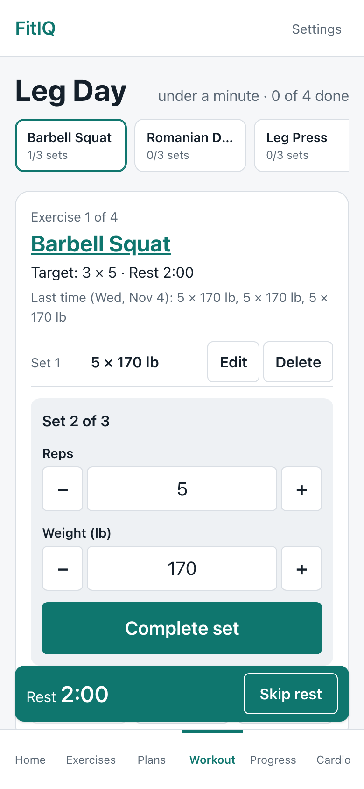
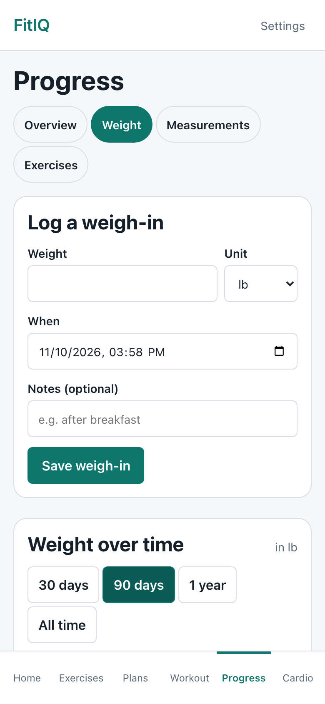
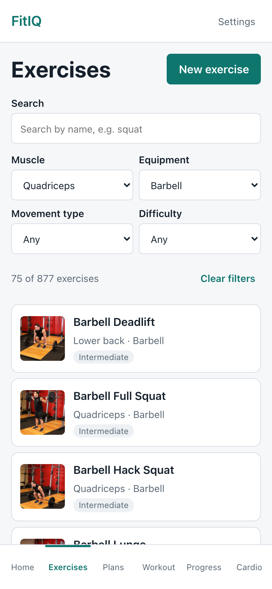
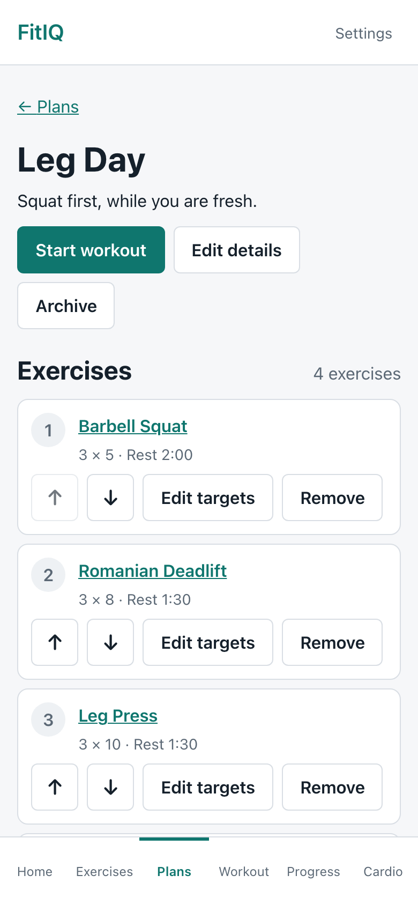

# FitIQ

A private workout and progress tracker for a household of 2 to 4 people. Plan your routines, log every set on your phone as you go, and watch your weight, measurements, and lifts change over time. It's installable as an app, and costs $0 a month to run.

<p align="center">
  
</p>

| Dashboard | Logging a set | Weight trend | Exercise library | Plan builder |
| --- | --- | --- | --- | --- |
|  |  |  |  |  |

## Try it

**Live:** [fitiq.bobbyjoecool.dev](https://fitiq.bobbyjoecool.dev)

Sign in with the shared demo account: **`demo@bobbyjoecool.dev`** / **`try-fitiq-demo`**. It's filled with about eight weeks of made-up workouts, weigh-ins, and cardio, and resets every week. Real family accounts are private: nobody, including the demo, can see anyone else's data.

## What it does

- **Exercise library:** 876 exercises from [Free Exercise DB](https://github.com/yuhonas/free-exercise-db) (public domain), with images and steps. Search and filter by muscle, equipment, movement type, and difficulty. Add your own exercises, with an optional video link.
- **Plans:** reusable routines with target sets, reps, hold time, rest, and notes, plus up/down reordering. Start from scratch or from a starter plan, such as a full-body stretch.
- **Workouts:** start from a plan or empty, then log one set at a time with −/+ steppers. "Last time" numbers prefill each set, and rest and hold timers run on their own. Each set saves the moment you complete it, so a closed browser or a sleeping phone loses nothing.
- **History and progress:** every workout set by set, workouts per week, per-exercise history with exact personal records, a weight chart by date range, and body measurement charts.
- **Cardio:** walks, runs, and a walking pad preset.
- **Yours:** pounds or kilograms, inches or centimetres (stored values are never rewritten), CSV export of all your data, and an account deletion request.
- **Phone first:** installable PWA, one-handed workout screen, opens offline with a clear offline banner.

## How it's built

React, TypeScript, and Vite on GitHub Pages. The browser talks straight to Supabase (Auth and Postgres), and privacy is enforced in the database: **Row Level Security on every table**, plus ownership triggers so no row can point at another person's data. A two-account RLS test checks every table, and Playwright tests the main flows in CI against a local Supabase stack. The design and its trade-offs are in **[docs/architecture.md](docs/architecture.md)**.

## Docs

- [`CHANGELOG.md`](CHANGELOG.md): what's in v1.0, what's being fixed now, and what's planned next
- [`docs/architecture.md`](docs/architecture.md): how the pieces fit, with a diagram
- [`plan.md`](plan.md): product and technical plan
- [`docs/build-plan.md`](docs/build-plan.md): phased build plan, one GitHub issue per step (tracked in [#1](https://github.com/BobbyJoeCool/FitIQ/issues/1))
- [`docs/exercise-sources.md`](docs/exercise-sources.md): exercise data license, the pinned dataset commit, and field mapping
- [`docs/accounts.md`](docs/accounts.md): adding, resetting, and removing accounts, and the demo account
- [`docs/backup-restore.md`](docs/backup-restore.md): backing up the hosted database and restoring it locally
- [`docs/adr/`](docs/adr/): architecture decisions, starting with delete behavior per table
- [`IMPORT-FORMATS.md`](IMPORT-FORMATS.md): the JSON import formats (plan files today), field by field, for writing a file by hand or with an AI assistant
- [`docs/future-versions.md`](docs/future-versions.md): upgrades planned after v1

## Setup

### Local development

Requires Node 24 and, for a local database, Docker.

```sh
npm install
cp .env.example .env    # then fill in the two values
npm run dev             # http://localhost:5173
```

`.env` holds only `VITE_SUPABASE_URL` and `VITE_SUPABASE_PUBLISHABLE_KEY`. Both end up in the public JS bundle, which is fine for the publishable key because Row Level Security protects the data. The secret (service-role) key and the database password never go in this repo or in any `VITE_` variable; the app refuses to start if it sees a secret key. If either value is missing, the app shows a configuration error page instead of a blank screen.

| Script | What it does |
| --- | --- |
| `npm run dev` | Dev server |
| `npm run build` | Typecheck and production build (also writes `dist/404.html` for SPA routing on Pages) |
| `npm run lint` | oxlint, including a rule that only `src/lib/` may import the Supabase client |
| `npm run typecheck` | TypeScript |
| `npm test` | Vitest unit and component tests |
| `npm run format` / `format:check` | Prettier |
| `npm run test:rls` | Two-account RLS test (see below) |
| `npm run seed:demo` | Fill the demo account with made-up data (`scripts/demo.env`; see [accounts](docs/accounts.md#the-public-demo-account-step-91)) |
| `npm run test:e2e` | Playwright end-to-end tests against the local Supabase stack (`npm run db:start` first) |
| `scripts/backup.sh` | Dump the hosted or local database, restore into the local stack, count rows ([docs](docs/backup-restore.md)) |

All database access goes through `src/lib/data/`. Components never import Supabase directly.

### Database migrations

Schema changes, including RLS policies, are SQL files in `supabase/migrations/`, applied with the Supabase CLI (installed as a dev dependency, so `npx supabase` works).

```sh
npm run db:new -- add_something   # create supabase/migrations/<timestamp>_add_something.sql
npm run db:start                  # local stack in Docker, built from the migrations alone
npm run db:reset                  # rebuild the local database from scratch
npx supabase link --project-ref <ref>   # once, to target the hosted project
npm run db:push                   # apply new migrations to the hosted project (--remote)
```

`npx supabase status` prints the local URL and publishable key for a local `.env`. Local auth mirrors the hosted rules: signups are off, so create local users in Studio (<http://127.0.0.1:54323>) or with the local admin API. No dashboard schema edits on the hosted project: if it isn't in a migration, it doesn't exist.

### RLS test (run before every rollout)

`tests/rls/rls-test.mjs` signs in as two test accounts with the publishable key and checks that neither can read, update, delete, or insert the other's rows on every user-owned table, and that a signed-out client sees nothing. It exits non-zero on any leak.

```sh
cp tests/rls/.env.example tests/rls/.env   # URL, publishable key, two TEST accounts
npm run test:rls
```

Run it against the hosted project before every rollout, and never put real family data in until it passes.

### Hosted setup (one time, owner only)

1. **Supabase project** (free tier). In Authentication > Sign In / Providers, turn off *Allow new users to sign up*. In Authentication > URL Configuration, set the Site URL to `https://fitiq.bobbyjoecool.dev` and add `http://localhost:5173` to the redirect URLs. Keep the secret key and database password in a password manager only.
2. **Migrations:** `npx supabase link --project-ref <ref>` then `npm run db:push`.
3. **Repo variables** (Settings > Secrets and variables > Actions > Variables, not secrets, since both values are public): `VITE_SUPABASE_URL` and `VITE_SUPABASE_PUBLISHABLE_KEY`. The deploy and keep-alive workflows read them.
4. **GitHub Pages:** Settings > Pages > Source: *GitHub Actions*.
5. **Custom domain:** add a DNS `CNAME` record `fitiq` → `bobbyjoecool.github.io`, then set `fitiq.bobbyjoecool.dev` as the custom domain in Settings > Pages and tick *Enforce HTTPS*. The deploy workflow picks up the base path from the Pages settings, so the build works at `bobbyjoecool.github.io/FitIQ/` before the domain is set and at `/` after; re-run the deploy once the domain changes.
6. **Accounts:** follow [`docs/accounts.md`](docs/accounts.md). Supabase's built-in email only reaches your own team, so the default is to create each account with a temporary password. A profile row is created automatically with imperial units.

### Deploys and keep-alive

- `.github/workflows/ci.yml` runs lint, format check, typecheck, unit and component tests, and a build on every pull request and push to `main`, plus a Playwright job against a local Supabase stack started from the migrations.
- `.github/workflows/deploy.yml` builds and publishes to GitHub Pages on every push to `main`.
- `.github/workflows/demo-reseed.yml` reseeds the demo account every Monday, once its variable and secret are set.
- `.github/workflows/keepalive.yml` runs one tiny database query (`keepalive()`) twice a week so the free Supabase project isn't paused. Supabase pauses Free-plan projects after a week without enough database activity ([Supabase docs](https://supabase.com/docs/guides/platform/free-project-pausing), checked 2026-11-08). It can also be run by hand from the Actions tab.
