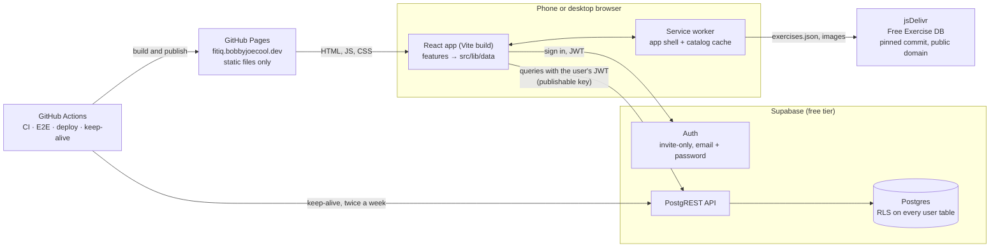

# Architecture

FitIQ is a static React app on GitHub Pages that talks straight to Supabase (Auth and Postgres) over HTTPS. There is no app server: privacy is enforced in the database with Row Level Security. Everything below is the v1 design from [plan.md](../plan.md). [Future versions](future-versions.md) covers what comes later.

## Frontend

- **React 19, TypeScript, Vite**, built to static files and served by **GitHub Pages**. `404.html` is a copy of `index.html`, so deep links work. The base path comes from the Pages settings (`/` on the custom domain, `/FitIQ/` before it).
- **Routing:** React Router. Screens live in `src/features/<area>/`: dashboard, exercises, workout-plans, workout-sessions, progress, cardio, settings, auth. Shared pieces live in `src/components/` and `src/hooks/`.
- **Phone first:** a bottom tab bar on phones and a sidebar on desktop. Controls are at least 44 px. The workout screen is built for one hand: −/+ steppers, a big Complete set button, rest and hold timers, and the screen kept awake.
- **PWA:** a manifest and a hand-written service worker (`public/sw.js`). The app shell is network-first with an offline fallback; the pinned catalog and images are cache-first. Data is never cached. Offline, an offline banner shows and saves are blocked rather than lost (plan.md section 10).
- **Charts:** two small SVG components (`src/components/charts/`), with hover and keyboard read-outs and a table view. There's no chart library.

## Data layer

**Every Supabase call lives in `src/lib/data/`**, and an oxlint rule stops components from importing Supabase. Each module maps rows to app types and turns errors into `DataError`s with messages a person can read:

| Module | Covers |
| --- | --- |
| `auth.ts` | Sign in and out, the session, invite and reset links, password change |
| `profiles.ts` | Display name, units, deletion request |
| `catalog.ts`, `exercises.ts` | The Free Exercise DB, fetched from jsDelivr at a pinned commit and merged with custom exercises |
| `customExercises.ts` | Your own exercises |
| `plans.ts` | Plans, their exercises and targets, reorder |
| `sessions.ts` | Starting, logging, and finishing workouts; history; per-exercise history |
| `tracking.ts` | Weigh-ins, measurements, cardio, progress queries, export |

Unit preferences come from a profile context. Every stored value keeps its own unit (each set, weigh-in, and measurement), and conversion happens only for display (`src/lib/units.ts`). Changing a preference never rewrites history.

## Auth and accounts

- **Supabase Auth**, email and password. **Public signups are off**: the owner creates each account ([accounts.md](accounts.md)).
- The browser holds only the **publishable key**. The app refuses to start with a secret key. The service-role key and database password never reach the frontend or the repo.
- Invite and reset emails link to `/auth/confirm` with a token hash. Supabase's built-in email only reaches the project's team, so the default is to create accounts with a temporary password; custom SMTP is optional.
- Account deletion is a request flag. The owner deletes the auth user, and every row cascades with it.

## Database and RLS

- **Schema as SQL migrations** in `supabase/migrations/`, applied with the Supabase CLI. There are no dashboard edits.
- **Tables:** `profiles`, `custom_exercises`, `workout_plans`, `workout_plan_exercises`, `workout_sessions`, `workout_session_exercises`, `workout_sets`, `weight_history`, `body_measurements`, `cardio_sessions`.
- **The catalog isn't in the database.** Plans and sessions store the dataset's text ID (`catalog_exercise_id`) or a `custom_exercise_id`, with a CHECK that exactly one is set. Sessions copy the exercise name and targets when the workout starts, so editing a plan or changing the catalog never rewrites history.
- **Privacy:** every user-owned table has `user_id`, RLS enabled, and owner-only policies (`auth.uid() = user_id`). Column grants stop `user_id` and parent IDs being changed. **Ownership triggers** make sure a child row's parents (plan, session, exercise) belong to the same user, which RLS alone can't check.
- **Delete behavior** is per relationship ([ADR 0001](adr/0001-delete-behavior.md)). Plans and custom exercises are archive-only; history records can be deleted by their owner; everything cascades from the auth user.
- **Two functions:** `start_workout` copies a plan into a new session in one transaction, and `reorder_plan_exercises` saves a new order atomically. Both are security invoker, so RLS still applies.

## Testing

| Layer | What | Where |
| --- | --- | --- |
| Unit | Units, validation, workout and progress math, CSV, scales | `src/**/*.test.ts` (Vitest) |
| Component | Every screen's main flows, errors, loading, empty states | `src/**/*.test.tsx` (Testing Library) |
| RLS | Two accounts, every table: read, update, delete, insert-as-other, cross-parent pointers, signed out | `tests/rls/rls-test.mjs`, run against hosted before rollouts |
| End to end | Sign in, plan, workout, history, weigh-in, and a second user who sees none of it | `tests/e2e/` (Playwright), local Supabase stack in CI |

## Deploy and operations

- **CI** (`ci.yml`): lint, format, typecheck, unit and component tests, and a build; plus Playwright against `supabase start`.
- **Deploy** (`deploy.yml`): every push to `main` builds and publishes to Pages. Migrations are pushed separately with `npm run db:push`, so the database changes only when the owner says so.
- **Keep-alive** (`keepalive.yml`): a tiny `keepalive()` RPC twice a week, so the free project isn't paused.
- **Demo data** (`demo-reseed.yml`, optional): reseeds the public demo account weekly.
- **Backups:** the Free plan has none you can download, so `scripts/backup.sh` dumps the hosted database and restores it locally ([backup-restore.md](backup-restore.md)).

## Portability

The backend is meant to be movable to the home server (plan.md section 5, [FV-3](future-versions.md)):

- No Supabase-only features in v1: no Edge Functions, Storage, or Realtime. Only Auth, PostgREST, and Postgres, all of which self-hosted Supabase provides.
- Plain SQL migrations and a tested dump-and-restore into a local stack.
- One data-access layer: moving changes only the two `VITE_SUPABASE_*` values.
- The self-hosted backend must be reachable over public HTTPS, because family members use the app outside the house.
